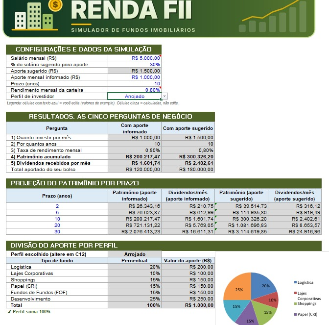
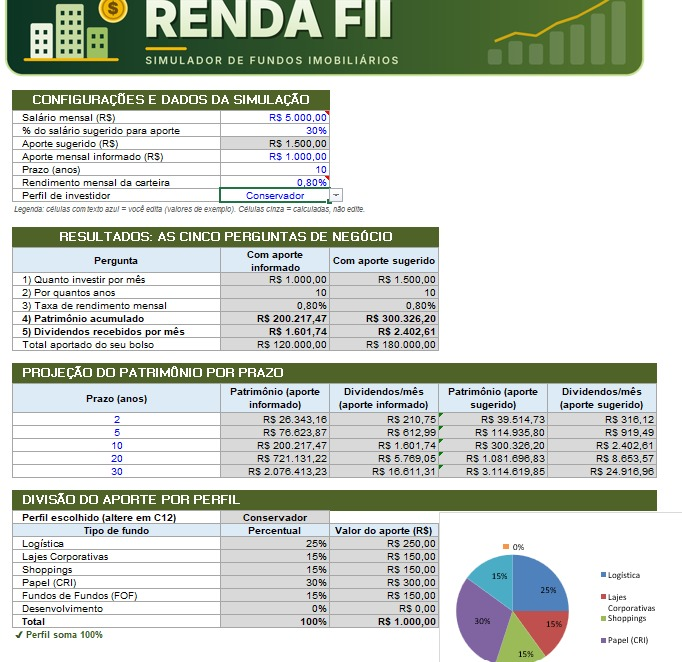

# Simulador de Fundos Imobiliários

Ferramenta em Excel que simula investimentos em fundos imobiliários (FIIs): do aporte de cada mês até os dividendos que ele rende, com projeção de 2 a 30 anos e divisão do aporte por perfil de investidor.

> Todos os valores do arquivo (salário, aporte, taxa e percentuais) são **exemplos**, não dados reais nem recomendação de investimento.

## Como usar

1. Abra `simulador_fundos_imobiliarios.xlsx` na aba **Simulador**.
2. Edite apenas as células com texto azul (seção 1).
3. Escolha o perfil na lista da célula `C12`.
4. Células cinza são calculadas: não edite.

## Perguntas que a ferramenta responde

Todas aparecem na seção **2. Resultados** da aba `Simulador` (células `C17:C21`):

| # | Pergunta | Célula | Origem |
|---|----------|--------|--------|
| 1 | Quanto investir por mês | `C17` | entrada `aporte` (`C9`) |
| 2 | Por quantos anos | `C18` | entrada `anos` (`C10`) |
| 3 | Taxa de rendimento mensal | `C19` | entrada `taxa_mensal` (`C11`) |
| 4 | Patrimônio acumulado | `C20` | função VF |
| 5 | Dividendos por mês | `C21` | patrimônio × taxa mensal |

A coluna `D` repete tudo usando o **aporte sugerido** (30% do salário).

## Como o VF e o PROCV entram nos cálculos

**VF (valor futuro)**

```
=-VF(taxa_mensal; anos*12; aporte)
```

- `taxa_mensal`: rendimento por período (mês).
- `anos*12`: número de períodos, em meses.
- `aporte`: pagamento feito a cada período.
- O sinal de menos existe porque o VF devolve valor negativo quando o pagamento é positivo.
- Os dividendos mensais são `patrimônio × taxa_mensal`.
- A tabela de cenários (seção 3) repete a mesma fórmula para 2, 5, 10, 20 e 30 anos, trocando só o prazo (`$B26*12`).

**PROCV com chave composta**

```
=PROCV(perfil&$B35; tabela_perfis; 4; FALSO)
```

- Na aba `Apoio`, a coluna A monta a chave `perfil + tipo de fundo` (ex.: `ModeradoShoppings`).
- Na tela, `perfil&$B35` monta a mesma chave com o perfil escolhido e o tipo de fundo da linha.
- O PROCV acha a chave na primeira coluna da tabela e devolve o percentual (coluna 4).
- Resultado: trocar o perfil na lista muda toda a divisão do aporte.

## Intervalos nomeados

| Nome | Refere-se a | Uso |
|------|-------------|-----|
| `salario` | `Simulador!C6` | salário mensal |
| `pct_sugestao` | `Simulador!C7` | % do salário sugerido para aporte (30%) |
| `aporte_sugerido` | `Simulador!C8` | `salario * pct_sugestao` |
| `aporte` | `Simulador!C9` | aporte mensal informado |
| `anos` | `Simulador!C10` | prazo em anos |
| `taxa_mensal` | `Simulador!C11` | rendimento mensal da carteira |
| `perfil` | `Simulador!C12` | perfil escolhido |
| `patrimonio` | `Simulador!C20` | patrimônio acumulado |
| `dividendos` | `Simulador!C21` | dividendos mensais |
| `tabela_perfis` | `Apoio!A5:D22` | tabela do PROCV |
| `lista_perfis` | `Apoio!F5:F7` | lista da validação de dados |

## Percentuais de cada perfil

Valores **ilustrativos, criados por mim** para este projeto. Não vêm de nenhuma fonte e não são recomendação de investimento. Cada perfil soma 100% (a aba `Apoio` confere isso automaticamente).

| Tipo de fundo | Conservador | Moderado | Arrojado |
|---|---|---|---|
| Logística | 25% | 20% | 20% |
| Lajes Corporativas | 15% | 15% | 10% |
| Shoppings | 15% | 15% | 15% |
| Papel (CRI) | 30% | 25% | 15% |
| Fundos de Fundos (FOF) | 15% | 15% | 15% |
| Desenvolvimento | 0% | 10% | 25% |
| **Total** | **100%** | **100%** | **100%** |

## O que mudei em relação à ferramenta do Expert

- Segunda simulação lado a lado, usando a sugestão de 30% do salário no lugar do aporte informado.
- Gráfico de pizza que muda junto com o perfil.
- Validação de dados também nas entradas numéricas (prazo, taxa, aporte, percentual).
- Verificação automática de que cada perfil soma 100%.
- Total aportado do próprio bolso, para comparar com o patrimônio final.
- *(complete com as suas próprias mudanças)*

# Prints





## Estrutura do repositório

```
simulador-fundos-imobiliarios/
├── simulador_fundos_imobiliarios.xlsx
├── README.md
└── prints/
```
